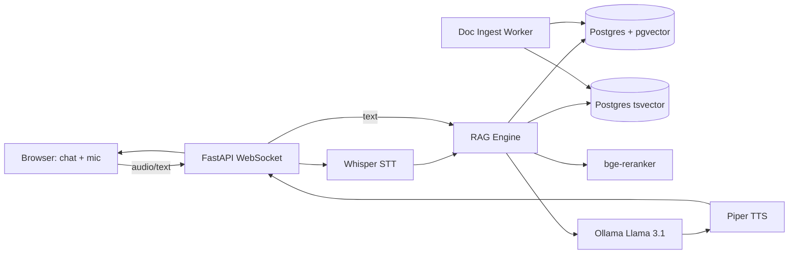

# RAG Voice + Text Support Bot (Flagship)

A production-grade Retrieval-Augmented-Generation customer support bot. **Voice-in, voice-out, text-in, text-out, with citations.** Runs **100% locally — no API keys needed** to demo.

[Live demo (TODO)](https://example.com) · [Video walkthrough (TODO)](https://example.com)

Most RAG demos on GitHub are notebooks. This one is a deployable product with hybrid retrieval, reranking, streaming, evaluation, and a real chat UI.

## What this demonstrates

- **Hybrid retrieval** — dense (pgvector cosine) + sparse (BM25 via Postgres `tsvector`) fused with **Reciprocal Rank Fusion**
- **Cross-encoder reranking** (`BAAI/bge-reranker-base`) on top-20 → top-5
- **Streaming responses** via WebSocket (token-by-token via Ollama streaming API)
- **Citations** in every answer — clickable source doc + chunk
- **Voice round-trip** — Whisper STT (`faster-whisper`) + Piper TTS (open-source neural TTS)
- **Multi-tenant** — each "company" has an isolated knowledge base
- **Doc ingestion pipeline** — PDF, HTML, Markdown via LangChain splitters
- **Eval harness** — RAGAS metrics on a seeded Q&A set (`make eval`)
- **100% local** — Docker Compose pulls Ollama + Llama 3.1 8B on first run
- **Modern React UI** — chat with mic button, waveform, source cards

## Architecture



## Tech stack

- **Python 3.11** + FastAPI + uvicorn
- **PostgreSQL 16 + pgvector** (vector + full-text in one DB)
- **Ollama** running **Llama 3.1 8B** (chat) + **nomic-embed-text** (embeddings) — open-source, no API key
- **faster-whisper** for STT (CPU-friendly Whisper port)
- **Piper TTS** for natural voice output
- **LangChain** for document loaders + splitters
- **sentence-transformers** for the reranker
- **React 18 + Vite + TS + Tailwind** frontend

## Quick start

```bash
git clone <repo>
cd ragvoice-support-bot
docker compose up -d
# First run: Ollama auto-pulls llama3.1:8b (~5GB) and nomic-embed-text (~250MB)
# Wait ~5min, then:
docker compose exec api python -m app.ingest /data/sample_docs
# Frontend: http://localhost:5173
# Backend:  http://localhost:8000
# Open in browser, type or click mic
```

Sample docs (Stripe API docs excerpts) are loaded by default so you can ask:
- "How do I create a payment intent?"
- "What's the difference between a charge and a payment intent?"

## API

| Method | Path                       | Description                          |
|--------|----------------------------|--------------------------------------|
| WS     | `/ws/chat?tenant=acme`     | Streaming chat (text + audio)        |
| POST   | `/api/ingest`              | Upload a doc to a tenant's KB        |
| GET    | `/api/sources?tenant=acme` | List ingested docs                   |
| POST   | `/api/eval`                | Run RAGAS eval (returns scores)      |

## WebSocket protocol

Client -> server:
```json
{ "type": "query", "text": "How do I refund a charge?" }
{ "type": "audio_chunk", "data": "<base64 PCM 16k>" }
{ "type": "audio_end" }                                 // triggers STT then RAG
```

Server -> client:
```json
{ "type": "token", "text": "To" }                       // streamed
{ "type": "citations", "items": [ {"doc": "...", "chunk": "..."} ] }
{ "type": "tts_audio", "data": "<base64 wav>" }
{ "type": "done" }
```

## Key implementation highlights

- **Hybrid retrieval + RRF**: [backend/app/retrieval.py](backend/app/retrieval.py)
- **WebSocket streaming with Ollama**: [backend/app/chat.py](backend/app/chat.py)
- **Ingestion pipeline (semantic chunking)**: [backend/app/ingest.py](backend/app/ingest.py)
- **Evaluation harness**: [backend/app/eval.py](backend/app/eval.py)

## Evaluation

`make eval` runs a small held-out Q&A set against the bot and prints RAGAS scores:

| Metric              | Score |
|---------------------|------:|
| Faithfulness        |  TODO |
| Answer Relevance    |  TODO |
| Context Precision   |  TODO |
| Context Recall      |  TODO |

(Scores recompute on every CI run.)

## Roadmap

- Multi-modal: image inputs (LLaVA)
- Conversation memory across sessions
- Auto-rewriting follow-up queries with conversation context
- Cost guardrails (token quota per tenant)
- GPU compose override for 10x faster inference

<!-- ownership:author -->
---

## Author

**Umair** &mdash; [@umairjutt](https://github.com/umairjutt)

Designed, built and maintained by me. Licensed under the [MIT License](LICENSE).