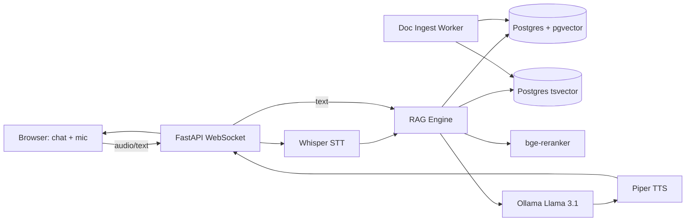

# RAG Voice + Text Support Bot

[CI results](https://github.com/umairjutt/ragvoice-support-bot/actions) · [Engineering guide](PORTFOLIO.md)

> **Status:** Experimental local RAG application. Dependency installation, authenticated tenant access, upload boundaries and voice-model provisioning need further work before multi-user deployment.

[](https://github.com/umairjutt/ragvoice-support-bot/actions/workflows/ci.yml)


An experimental retrieval-augmented support assistant with streamed text, source references and voice integration. Local inference uses Ollama; initial setup downloads models and requires appropriate hardware.

The project explores how retrieval, conversation memory, caching and streamed responses fit together in an application.

## What this demonstrates

- **Hybrid retrieval** — dense (pgvector cosine) + sparse (PostgreSQL full-text ranking with `ts_rank`) fused with **Reciprocal Rank Fusion**
- **HyDE query expansion** — a hypothetical answer is generated and embedded to lift dense recall
- **Cross-encoder reranking** (`BAAI/bge-reranker-base`) on top-20 → top-5
- **Conversation memory + follow-up rewriting** — a "condense question" LLM step resolves pronoun-laden follow-ups against session history (`app/memory.py`)
- **Grounding heuristic** — answers are scored against retrieved context; ungrounded answers are flagged and never cached (`app/chat.py`)
- **Answer + embedding caching** in Redis, with hit/miss counters surfaced at `/metrics`
- **Streaming responses** via WebSocket (token-by-token via Ollama streaming API)
- **Citations** in every answer — clickable source doc + chunk
- **Voice round-trip** — Whisper STT (`faster-whisper`) + Piper TTS (open-source neural TTS)
- **Tenant-filtered retrieval** — queries filter by a supplied tenant; authenticated tenant authorization remains
- **Doc ingestion + admin** — PDF/HTML/Markdown via LangChain splitters; list/delete docs and trigger reindex
- **Evaluation harness** — context precision/recall, faithfulness, and answer-contains on a seeded gold set; runs **offline in CI** (`python -m app.eval --ci`) and gates on thresholds
- **Observability** — per-stage latency (retrieval/rerank/LLM) + token counters at `/metrics`
- **Quality gates** — ruff + mypy + pytest (fake Ollama client) in CI
- **100% local** — Docker Compose pulls Ollama + Llama 3.1 8B on first run
- **Modern React UI** — chat with mic button, waveform, source cards

## Architecture



## Tech stack

- **Python 3.11** + FastAPI + uvicorn
- **PostgreSQL 16 + pgvector** (vector + full-text in one DB)
- **Ollama** running **Llama 3.1 8B** (chat) + **nomic-embed-text** (embeddings) — open-source, no API key
- **faster-whisper** for STT (CPU-friendly Whisper port)
- **Piper TTS** for natural voice output
- **LangChain** for document loaders + splitters
- **sentence-transformers** for the reranker
- **React 18 + Vite + TS + Tailwind** frontend

## Quick start

```bash
git clone https://github.com/umairjutt/ragvoice-support-bot.git
cd ragvoice-support-bot
docker compose up -d
# First run: Ollama auto-pulls llama3.1:8b (~5GB) and nomic-embed-text (~250MB)
# Wait ~5min, then:
docker compose exec api python -m app.ingest /data/sample_docs
# Frontend: http://localhost:5173
# Backend:  http://localhost:8000
# Open in browser, type or click mic
```

Sample docs (Stripe API docs excerpts) are loaded by default so you can ask:
- "How do I create a payment intent?"
- "What's the difference between a charge and a payment intent?"

## API

| Method | Path                                | Description                          |
|--------|-------------------------------------|--------------------------------------|
| WS     | `/ws/chat?tenant=acme&session_id=…` | Streaming chat (text + audio) with memory |
| POST   | `/api/ingest`                       | Upload a doc to a tenant's KB        |
| GET    | `/api/sources?tenant=acme`          | List ingested docs                   |
| DELETE | `/api/documents/{id}?tenant=acme`   | Delete a doc and its chunks          |
| POST   | `/api/admin/reindex?tenant=acme`    | Re-embed a tenant's chunks           |
| GET    | `/metrics`                          | JSON latency/token/cache metrics     |
| GET    | `/metrics/prometheus`               | Prometheus exposition                |
| GET    | `/docs`                             | OpenAPI / Swagger UI                 |

## WebSocket protocol

Client -> server:
```json
{ "type": "query", "text": "How do I refund a charge?" }
{ "type": "audio_chunk", "data": "<base64 PCM 16k>" }
{ "type": "audio_end" }                                 // triggers STT then RAG
```

Server -> client:
```json
{ "type": "rewrite", "original": "what about refunds?", "rewritten": "How do I issue a refund?" }
{ "type": "citations", "items": [ {"index": 1, "document_id": 3, "chunk_id": 12, "text": "...", "score": 0.91} ] }
{ "type": "token", "text": "To" }                       // streamed
{ "type": "grounding", "grounded": true, "overlap": 0.42 }
{ "type": "tts_audio", "data": "<base64 wav>" }
{ "type": "done" }
```

## Key implementation highlights

- **Hybrid retrieval + RRF + HyDE**: [backend/app/retrieval.py](backend/app/retrieval.py)
- **WebSocket streaming + grounding guardrail**: [backend/app/chat.py](backend/app/chat.py)
- **Conversation memory + question condensing**: [backend/app/memory.py](backend/app/memory.py)
- **Redis answer/embedding cache**: [backend/app/cache.py](backend/app/cache.py)
- **Ingestion + admin (delete/reindex)**: [backend/app/ingest.py](backend/app/ingest.py)
- **Evaluation harness**: [backend/app/eval.py](backend/app/eval.py)
- **Metrics**: [backend/app/metrics.py](backend/app/metrics.py)

## Evaluation

Two modes:

```bash
make eval            # live: scores the gold set against the running bot
make eval-ci         # offline: deterministic stub corpus, gates on thresholds, writes eval_report.json
```

Offline mode validates the harness using a deterministic stub and a small gold set; it does not measure actual model quality. CI is configured to run it after dependency and code checks succeed. Metrics computed:

| Metric              | Meaning                                                    | CI gate |
|---------------------|------------------------------------------------------------|--------:|
| Context Recall      | gold-relevant chunk present in retrieved set               | ≥ 0.99 |
| Context Precision   | fraction of retrieved chunks that are relevant             | ≥ 0.30 |
| Faithfulness        | answer terms supported by retrieved context (grounding)    | ≥ 0.40 |
| Answer Contains     | gold keyword present in the answer                         | ≥ 0.99 |

## Roadmap

- Multi-modal: image inputs (LLaVA)
- Conversation memory across sessions
- Auto-rewriting follow-up queries with conversation context
- Cost guardrails (token quota per tenant)
- GPU Compose configuration and measured hardware-specific inference results

<!-- ownership:author -->
---

## Author

**Umair** &mdash; [@umairjutt](https://github.com/umairjutt)

Maintained by [Umair Jutt](https://github.com/umairjutt). See [LICENSE](LICENSE) for repository licensing.
